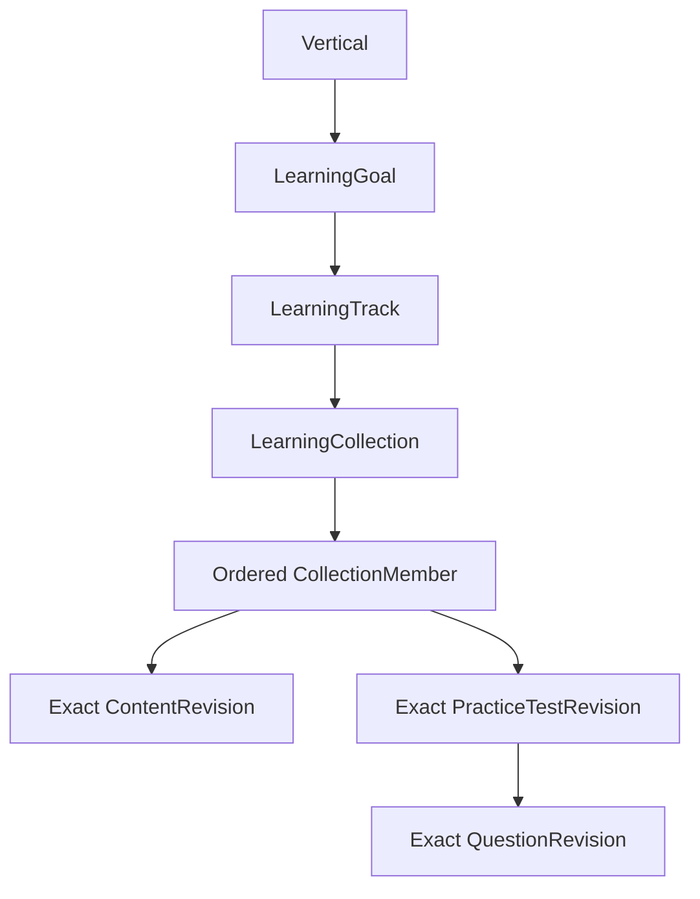
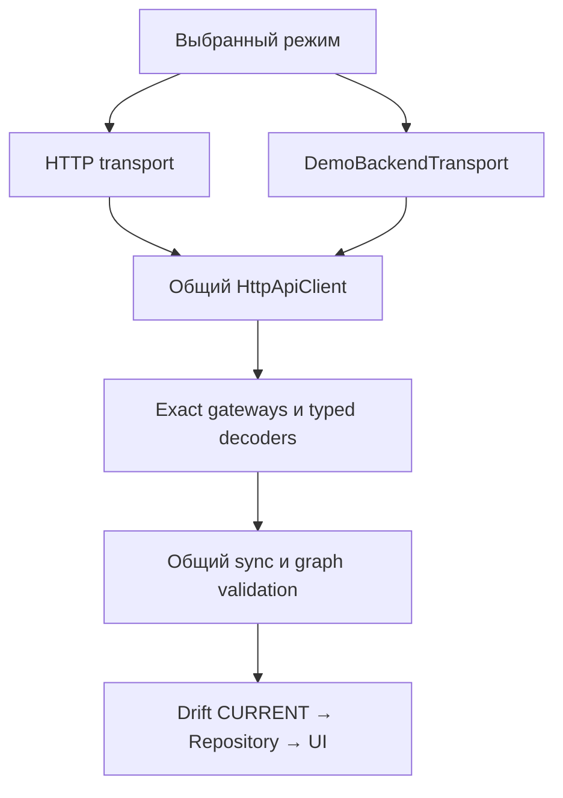

# ТЗ: Universal Vertical Catalogue

**Проект:** CareerSpeak / VoxPrep  
**Ветка:** `feat/universal-vertical-catalogue`  
**Версия ТЗ:** 1.0, 31.10.2026  
**Статус:** подготовлено к реализации; приёмка реализации не выполнена.  
**Проверенная исходная точка:** `97d73485a4011224c247cde3c896091c99aa53bc`.

Документ заменяет архитектурный proposal по этому пути. Он определяет целевое поведение, ограничения, изменения контрактов и проверяемые результаты. Новые решения этого ТЗ не означают, что соответствующий код уже существует или прежние контракты уже изменены.

## 1. Цель и границы продукта

CareerSpeak должен поддерживать новые учебные направления без отдельных экранов, контроллеров, репозиториев и доменных моделей для каждого направления.

Направления: Java Interview, QA Interview, DevOps Interview, AWS, Kubernetes, IELTS Technical Vocabulary, Medical English, Sales English, Banking English. Список открытый; названия и коды являются данными backend.

Сохраняется назначение продукта: изучение английского языка, профессиональная коммуникация и подготовка к интервью. AWS/Kubernetes могут задавать тематику английского материала, но это ТЗ само по себе не превращает приложение в отдельную платформу сертификации.

**Основной критерий:** после однократного внедрения универсального контракта ADMIN добавляет ранее неизвестное направление, публикует его, и уже установленный совместимый Flutter-клиент показывает полный учебный маршрут без изменения своего кода.

Новое направление использует существующие возможности `vocabulary`, `interview`, `topic`, `phrase`, `shadowing`, тесты `singleChoice` и общий TTS. Новый вид упражнения или новый протокол требует отдельного расширения контракта; произвольная вертикаль не означает произвольную исполняемую функциональность.

## 2. Исходное состояние и приоритет контрактов

На проверенном SHA:

| Область | Наблюдаемое состояние | Требуемое изменение |
|---|---|---|
| Каталоги | `CatalogueKind` содержит восемь видов, без `verticals` | Добавить девятый вид |
| Goal / Track / Collection | Нет `verticalCode` | Ввести явную принадлежность |
| Collection | C4 wire использует `members[]`; C2 projection ещё имеет раздельные refs | Сохранить единственный нормативный межтиповой порядок |
| Доставка каталога | Есть exact HTTP gateway и CURRENT-only Drift repository | Добавить типизированный decoder и полную проверку графа |
| Snapshot | Есть exact membership, атомарность и проверки immutable manifest | Расширить эти механизмы, не создавать второй CURRENT |
| Версии | Manifest schema и app contract в коде равны 1 | Спроектировать и проверить переход 1 → 2 |
| Backend | В дереве есть спецификации/контракты, Flutter и Python Worker; Spring Boot модуля нет | Реализацию backend учитывать отдельным обязательным результатом |

Опорные документы:

- [C2: typed content и каталоги](C2_TYPED_CONTENT_CATALOG_CONTRACT.md).
- [C3: assessment](C3_ASSESSMENT_CONTRACT.md).
- [C4: атомарная публикация](C4_ATOMIC_PUBLICATION_CONTRACT.md) и [roadmap](C4_IMPLEMENTATION_ROADMAP.md).
- [C1: локализация](C1_LOCALIZATION_FALLBACK_CONTRACT.md).
- [C5: installation/security](C5_INSTALLATION_EXTERNAL_SECURITY_CONTRACT.md).
- [Media security](C5_MEDIA_SECURITY_CONTRACT.md).
- [Retention и offline lifecycle](../specification/CAREERSPEAK_CONTENT_DELIVERY_RETENTION.md).

Это ТЗ расширяет C2/C3/C4 только в явно перечисленных местах. Алгоритмы scoring, TTS, C5 и durable learner state сохраняются. Для каталога действует C4: одна manifest truth path и локальная пагинация; старые примеры независимых learner list API из общих документов не являются основанием добавлять второй источник каталога.

Нельзя считать весь C4 принятым только по наличию кода. Перед изменением его жизненного цикла V0 фиксирует реальные результаты базовых проверок и открытые дефекты.

## 3. Объём реализации

### 3.1. Обязательный MVP

1. Backend-owned Vertical и связи со всем учебным графом.
2. Общая типизированная модель content/assessment для всех направлений.
3. Scoped categories/skills и общие levels/locales/voices.
4. Immutable catalogue revisions, exact membership и атомарная публикация.
5. Версионированные wire-контракты и безопасная миграция существующих данных.
6. Flutter: typed decoding, Drift, единый repository, маршруты и выбор направления.
7. Иконки через FileAsset / manifest descriptors / AssetResolver.
8. Минимальный ADMIN authoring: создание, редактирование, preview, validation, publish.
9. Offline/restart, история прогресса, ошибки и adversarial qualification.
10. Пользовательская кнопка «Демо-режим»: эмуляция backend через тот же production pipeline, с отдельными данными и сценариями загрузки.

### 3.2. За пределами MVP

Marketplace курсов, платежи, подписки, организации/тенанты, новый RBAC, личные learner accounts, рекомендации/AI tutor, граф prerequisites, произвольный workflow, EAV, конструктор экранов, исполняемые backend UI scripts и новые виды упражнений.

Не вводить отдельный микросервис каталога, отдельную БД на направление, enum со всеми направлениями или новые очереди. Backend остаётся Spring Boot modular monolith; ADMIN — один существующий защищённый аккаунт; Flutter — installation token; Worker — machine token.

## 4. Учебная модель



| Сущность | Смысл | Кардинальность MVP |
|---|---|---|
| Vertical | Предметное направление английского обучения | Несколько goals |
| LearningGoal | Результат обучения: например, пройти интервью | Ровно одна vertical, несколько tracks |
| LearningTrack | Учебный маршрут в рамках цели | Ровно один goal, несколько collections |
| LearningCollection | Упорядоченный учебный блок | Ровно один track, минимум один member |
| CollectionMember | Ссылка на контент либо тест | Ровно одна exact revision одного типа |
| Content / PracticeTest / Question | Общий учебный материал | Ровно одна vertical; повторное использование внутри неё |

Пример: `MEDICAL_ENGLISH → PATIENT_COMMUNICATION → MEDICAL_B1 → PATIENT_HISTORY → phrase, shadowing, practiceTest`.

В MVP не создавать DAG со множеством родителей. Один контент или тест допустим в нескольких collections своей vertical, а один вопрос — в нескольких тестах своей vertical. Повторение не копирует immutable revision, asset bytes и learner progress.

Общий контент сразу в нескольких vertical отложен. При необходимости повторного использования между направлениями ADMIN явно создаёт отдельную бизнес-идентичность; двоичные assets могут переиспользоваться. Нельзя обходить scope через `verticalCode=null` для content/test/question.

## 5. Идентичности и ограничения

**UV-01.** `code` — стабильная бизнес-идентичность, не перевод и не заголовок. Для Vertical/Goal/Track/Collection/Category/Skill/Level применяется текущий формат `^[A-Z0-9][A-Z0-9._-]*$`; новые коды ограничены 128 ASCII-символами. Существующие content/test/question identities сохраняют C2/C3-формат BusinessCode.

**UV-02.** Коды уникальны глобально в пределах своего типа. Одинаковый `categoryCode` в двух направлениях запрещён: существующие wire-ссылки не содержат составного ключа. При необходимости использовать смысловой префикс. `verticalCode` — scope, а не новая часть ключа content/progress.

**UV-03.** Код нельзя переименовать или переиспользовать после создания. Идентичность content включает существующий `contentType`; вид content нельзя менять под старой идентичностью. Заголовки, описание, порядок и доступность редактируются через новую публикацию.

**UV-04.** Vertical ownership фиксируется до первой публикации. Перенос опубликованных Goal/Track/Collection/Content/Test/Question в другую vertical в MVP запрещён. Перемещение draft допустимо только после повторной проверки всего затронутого графа. Смена родителя внутри одной vertical возможна в следующем snapshot.

**UV-05.** Одна логическая revision никогда не получает другой checksum. Счётчики revisions не сбрасываются при смене schemaVersion. Старые bytes, refs, локализации и результаты тестов не переписываются.

## 6. Backend: authoring и persistence

Физические имена таблиц ниже целевые; согласовать их с фактической backend foundation в V1. Это не утверждение о существующей схеме.

| Таблица/агрегат | Обязательные данные и ограничения |
|---|---|
| `learning_vertical` | `id`, unique immutable `code`, canonical English `title`, `description`, nullable `icon_asset_id`, `sort_order`, `active`, optimistic `version`, audit timestamps |
| `learning_goal` | stable code, NOT NULL `vertical_id`, presentation/order/active/version |
| `learning_track` | stable code, `goal_id`, NOT NULL `vertical_id`, `level_id`, optional `career_track_code`, presentation/order/active/version |
| `learning_collection` | stable code, `track_id`, NOT NULL `vertical_id`, presentation/order/active/version |
| `learning_collection_member` | `collection_id`, `position`, discriminated exact content/test revision FK; unique position; ровно одна target-ссылка |
| Content / Test / Question authoring | NOT NULL `vertical_id`, существующая бизнес-идентичность, отдельные immutable revision records |
| Category | stable code, nullable `vertical_id`, nullable `parent_category_id`, label/order/active |
| Skill | stable code, nullable `vertical_id`, label/order/active |
| Level / SupportedLocale / TtsVoice | Общие справочники; существующие семантики |
| CatalogueRevision | `kind`, monotonically increasing `revision`, `schema_version`, `checksum`, frozen payload; unique `(kind, revision)` |
| Publication catalogue membership | Точная ссылка из snapshot на `(kind, revision, checksum)` |

Требования к данным:

- `title`: непустой, до 200 символов; `description`: непустой, до 4000; `sortOrder`: целое `0..2147483647`; длина текста измеряется Unicode code points. Политика применяется к новым catalogue DTO.
- Поля принимаются/нормализуются на authoring boundary; опубликованные строки NFC-normalized. Flutter проверяет исходный wire, не исправляет его перед hash.
- Чужой parent/vertical отклоняется application validator и DB constraints, где возможно: например, составной FK `(goal_id, vertical_id)` на unique `(id, vertical_id)`.
- CHECK discriminated member + FK на конкретную revision; нельзя хранить единственный произвольный JSON вместо обязательных связей.
- Позиции members хранятся как последовательность `0..N-1`. Операция reorder атомарна и защищена optimistic locking.
- Индексы как минимум на `vertical_id`, parent FK, `(parent_id, sort_order, code)`, `(kind, revision)` и snapshot membership. Проверить планы запросов на qualification dataset.
- Удаление опубликованной identity и каскадное удаление immutable revisions запрещены. Retention работает отдельно и учитывает refs/history.
- HTTP DTO, JPA entity, immutable publication payload и Flutter domain type — разные модели. Не сериализовать JPA сущности в learner API.

### 6.1. Категории и навыки

`vertical_id=null` разрешён только для действительно общей taxonomy: например `LISTENING`, `READING`, `SPEAKING`, `VOCABULARY`.

Category/Skill доступны материалу, если их scope глобальный либо равен vertical материала. `JAVA_CONCURRENCY` нельзя привязать к медицинскому материалу. Category имеет одного parent; циклы запрещены. Дочерняя Category имеет тот же scope, что parent, либо scoped Category может ссылаться на global parent. Global child не может иметь scoped parent.

Scope опубликованной Category/Skill неизменяем; для изменения создаётся новая identity. Level остаётся общим языковым уровнем, не используется как замена certification level или vertical.

`careerTrackCode` сохраняется как optional taxonomy reference из C2; он не заменяет ни `LearningTrack`, ни `Vertical`.

## 7. Learner projections и версия wire

### 7.1. VerticalProjection

| Поле | Тип | Правило |
|---|---|---|
| `code` | string | Стабильный уникальный код |
| `title` | string | Canonical English, непустой |
| `description` | string | Canonical English, непустой |
| `iconAssetId` | string или null | Поле присутствует; только stable asset identity |
| `sortOrder` | integer | Неотрицательный |
| `active` | boolean | Замороженное состояние этой публикации |

### 7.2. Остальные projections

| Projection | Изменение относительно C2/C3/C4 |
|---|---|
| LearningGoal | Обязательный `verticalCode` |
| LearningTrack | Обязательный `verticalCode`; сохраняется `goalCode` |
| LearningCollection | Обязательный `verticalCode`; сохраняются `trackCode` и единый `members[]` |
| Category | Обязательные nullable `verticalCode`, `parentCategoryCode` |
| Skill | Обязательный nullable `verticalCode` |
| TypedContentPayload | Новый envelope v2 с обязательным `verticalCode`; typed body не меняется |
| PracticeTestRevision | Новый envelope v2 с обязательным `verticalCode`; scoring и exact question refs не меняются |
| QuestionRevision | Новый envelope v2 с обязательным `verticalCode`; `singleChoice` body не меняется |
| Level / SupportedLocale / TtsVoice | Семантика items не меняется |

Принадлежность content/test/question проверяется по их checksum-verified exact payload, а не по префиксу code, выбранной вкладке или единственной collection, в которой материал удалось найти.

### 7.3. Однократное изменение версии контракта

Целевой формат: root `schemaVersion=2`, `minimumAppContractVersion=2`. Root сохраняет locale-independent identity и existing exact refs. Совместимый клиент умеет читать root schema 1 и 2; pack schema 1 остаётся допустимой, пока структура pack не изменена.

У новых catalogue payloads, TypedContentPayload, PracticeTestRevision и QuestionRevision обязательное top-level поле `schemaVersion: 2`. Оно входит в checksum. Все девять каталогов нового root используют v2 envelope; неизменившиеся схемы items сохраняются. Новая версия metadata сама по себе не требует нового URL prefix.

Legacy payload без `schemaVersion` распознаётся только выделенным decoder v1 со старым allowlist. Нельзя автоматически дописывать `verticalCode` в старый JSON или трактовать malformed v2 как v1. Root v2 не может ссылаться на unscoped v1 content/test/question или catalogue.

В V1 создать версии компонентов C2/C3/C4 v2 и learner root schema v2, оставив v1 для legacy exact reads. Примеры имён будущих файлов: `contracts/c2-content-catalog-v2.yaml`, `contracts/c3-assessment-v2.yaml`, `contracts/c4-catalogue-publication-v2.yaml`. Все схемы и golden fixtures должны быть согласованы до production cutover.

### 7.4. Пример нового каталога

Checksum ниже — placeholder, а не валидный fixture. Реальные fixtures V1 содержат вычисленные digest.

```json
{
  "schemaVersion": 2,
  "kind": "verticals",
  "revision": 1,
  "checksum": "<computed-sha256>",
  "items": [
    {
      "code": "MEDICAL_ENGLISH",
      "title": "Medical English",
      "description": "English for patient communication",
      "iconAssetId": null,
      "sortOrder": 20,
      "active": true
    }
  ]
}
```

`CatalogueKind.verticals` — допустимое расширение enum видов протокола. Enum значений `JAVA_INTERVIEW`, `MEDICAL_ENGLISH` и подобных в production-коде запрещён.

Конкретные значения vertical codes разрешены в backend data, JSON fixtures и тестовых assertions. Их использование для выбора UI, repository, validator, player, scoring или маршрута запрещено. Демо-режим подчиняется тому же правилу.

## 8. Ordered membership и целостность графа

**UV-06.** Нормативная последовательность collection — только `members[]`, сохраняющая чередование: content → test → content. Раздельные `contentRefs`/`practiceTestRefs` допустимы только как производные представления; восстановить из них исходный межтиповой порядок нельзя.

Member сохраняет C4 shape: `kind=content` с `contentCode/contentType/revision/checksum` либо `kind=practiceTest` с `practiceTestCode/revision/checksum`. Порядок определяется позицией в массиве; второе wire-поле `order` для collection не вводится. `order` в C3 question refs сохраняется по прежнему контракту.

**UV-07.** Дубликат логической exact identity внутри одной collection запрещён, даже если checksum отличается. В одном snapshot для одной content identity или test code допускается только одна learner-current revision. Та же exact revision может быть переиспользована между collections/pack refs без неоднозначности.

**UV-08.** Перед публикацией и перед локальным CURRENT switch проверяется полный граф:

1. Все девять видов catalogue присутствуют ровно по одному exact ref; пустой `verticals.items` допустим для пустого продукта.
2. Codes внутри каждого catalogue уникальны.
3. Goal ссылается на существующую Vertical; Track — на Goal той же Vertical; Collection — на Track той же Vertical.
4. Exact member принадлежит этому snapshot и vertical его Collection.
5. Все exact вопросы входят в транзитивное замыкание теста этого snapshot и принадлежат vertical теста. Вопросы не требуют второго независимого current-list endpoint.
6. Category/Skill/Level refs существуют и удовлетворяют scope; category graph ацикличен.
7. Non-null iconAssetId разрешается в непротиворечивый asset descriptor того же snapshot.
8. Активная Collection содержит хотя бы одного deliverable member; dangling/retired refs запрещены также в опубликованных inactive collections.
9. Publication не может одновременно содержать tombstone identity и активное membership той же identity.
10. Payload checksum реально пересчитан и равен exact ref; совпадения строк `checksum` недостаточно.

Обнаруженная ошибка отклоняет весь candidate snapshot. Flutter не удаляет плохой элемент, не меняет его scope и не сортирует повреждённые members ради успешной активации.

## 9. Публикация, доступность и неизменяемость

### 9.1. Одна атомарная граница

Authoring → validate → freeze exact revisions/catalogues/assets → stage complete snapshot → compare-and-switch CURRENT → commit.

Все каталоги и refs относятся к одному root contentVersion. Отдельный CURRENT для выбранной vertical запрещён. В MVP все catalogue metadata синхронизируются как единый граф; выбор vertical ограничивает browsing и media intent, но не создаёт частичный root.

Backend читает согласованный authoring baseline: транзакционный snapshot или зафиксированные revision IDs и optimistic versions. Если автор изменил связанные данные после validation, publish повторно проверяет baseline либо возвращает conflict. Проверять граф A и коммитить изменившийся граф B нельзя.

Конкурирующие publishers сериализуются на DB boundary. Команда publish содержит expected CURRENT и idempotency key: повтор того же запроса возвращает прежний результат, другое тело с тем же ключом — conflict. Проигравшая конкурирующая публикация не переключает pointer и не перезаписывает победителя.

RustFS/asset bytes подготавливаются до переключения pointer; DB-транзакция не считается транзакцией над объектным хранилищем. Неиспользуемые staged объекты убираются отдельно. Missing/unverified referenced object блокирует публикацию.

### 9.2. Checksum и порядок

Применяется C2 RFC 8785 / SHA-256: UTF-8 canonical JSON с исключением только собственного top-level `checksum`. Вложенные checksums, `schemaVersion`, `verticalCode`, nullable поля, `active`, порядок members и остальные immutable поля включены.

Publication builder формирует catalogue items в порядке `(sortOrder, code)`; одинаковый sortOrder разрешён, code — unique tie-breaker. Все массивы сохраняют опубликованный порядок. UI может строить собственное сортированное read view, но не менять hashed source.

Правка title/icon/order/active создаёт новую catalogue revision и новый root; изменение ownership/нового envelope создаёт новую content/test/question revision. Старые bytes остаются точными. Неизменённые exact resources можно переиспользовать в разных snapshot.

### 9.3. Active, archive и tombstones

`active` в learner payload — неизменяемое значение внутри конкретной revision. Оно не считывается из текущей authoring row при каждом запросе.

| Событие | До commit новой публикации | После commit |
|---|---|---|
| ADMIN выключил Vertical в draft | Прежняя vertical видима | Она и её потомки недоступны для нового выбора |
| Publish завершился ошибкой | CURRENT сохраняется | Изменения видимости отсутствуют |
| Вертикаль снова включена | Старый snapshot не меняется | Новая публикация возвращает разрешённый маршрут |
| Контент retired | Старый CURRENT работает | Применяется C4 content tombstone и retention |

Видимость узла = собственный `active` AND `active` всех родителей. Потомков не требуется массово переписывать при отключении родителя. Их валидные immutable refs можно сохранить в snapshot как inactive navigation graph. Нельзя показывать scoped content через общий search в обход inactive vertical.

Архивирование Vertical/Goal/Track не создаёт каскадные content tombstones, не очищает историю и не удаляет общие assets. Для недоступности конкретного content применяется существующая C4 tombstone-семантика. Это ТЗ не расширяет правила повторной публикации tombstoned content.

История/уже загруженное exact упражнение могут сохраняться по действующей retention policy с признаком недоступности в текущем каталоге. Деактивация каталога не является отзывом уже скачанных данных на offline-устройстве и не заменяет C5 authorization.

## 10. API и ADMIN Studio

### 10.1. Learner API

| Операция | Контракт |
|---|---|
| Получить root | Существующий root endpoint; v2 содержит exact ref `verticals` и остальные каталоги |
| Получить каталог | `GET /api/v1/catalogues/{catalogueKind}/revisions/{revision}` |
| Получить content | Существующий C2 exact revision endpoint |
| Получить test/question | Существующие C3 exact revision endpoints |
| Получить media access | Существующий C5 resolver по stable delivery identity |
| Просмотреть/искать/пагинировать | Локальный Flutter repository по одному CURRENT snapshot |

Exact catalogue revision возвращается целиком. Независимая пагинация/фильтрация immutable ответа, `?verticalCode=...`, `?locale=...`, implicit `latest` и user-specific body запрещены. Одна revision имеет один body для всех авторизованных installations.

Checksum сравнивается с manifest ref и пересчитывается. ETag — transport representation digest по принятой C4 семантике. Кэш ключует минимум kind/revision/checksum. Exact path не меняет revision после bounded C5 token recovery.

Legacy exact payloads остаются доступны в установленное retention window. Несуществующий exact revision — typed 404; нет fallback на новую revision. Неподдерживаемая версия сохраняет прежний локальный CURRENT и сообщает необходимость обновления.

### 10.2. Минимальный ADMIN workflow

В существующем Spring MVC Content Studio: список Vertical → выбранное направление → Goals/Tracks/Collections/Categories/Skills/Content/Tests → validation preview → publish.

Обязательные операции: create/update, enable/disable, reorder, выбрать iconAssetId, редактировать ordered members с указанием exact revision, увидеть ошибки, просмотреть изменение публикации и опубликовать.

Внутренние MVC routes предлагаются как `/admin/verticals` и scoped страницы `/admin/verticals/{code}/...`; V1 фиксирует их вместе с существующими admin conventions. Отдельный публичный Admin REST API не является условием MVP.

- Vertical scope задаётся формой и повторно проверяется сервером; hidden field не считается защитой.
- Списки выбора показывают допустимый scope и global taxonomy; прямой чужой ID также отклоняется.
- Preview содержит counts по vertical, изменения доступности, unresolved refs и paths ошибок.
- Save использует expected entity version; publish — expected baseline; stale request возвращает 409/conflict без перезаписи.
- Применяются существующие session security, CSRF и audit. Password/tokens/PII не входят в publication или logs.
- Draft может быть неполным; publish не может. Нельзя фиксировать новую vertical в mobile seed как замену ADMIN flow.

## 11. Flutter: repository, UX и локальная работа

### 11.1. Production path

`HTTP exact payload → typed decoder → checksum + graph validation → staged Drift → atomic CURRENT → repository → Riverpod → generic UI`.

Ввести `VerticalProjection` и общий `LearningCatalogueRepository`. Предлагаемые операции:

```text
watchNavigation() -> catalogue view + sourceContentVersion
listVerticals()
listGoals(verticalCode)
listTracks(verticalCode, goalCode)
listCollections(verticalCode, trackCode)
readOrderedCollection(verticalCode, collectionCode)
searchContent(verticalCode, filters, cursor, limit)
```

Это целевая семантика порта; Dart signatures согласовать с текущими Result/stream conventions. Отдельный VerticalRepository допустим как тонкая часть того же источника данных, без второго кэша и другой selection policy.

**UV-09.** Все запросы ограничены одной зафиксированной CURRENT identity. Нельзя отдельно прочитать Vertical из N и Track из N+1. Использовать read transaction/snapshot view; возвращать `sourceContentVersion`; при смене публикации перестроить весь navigation state.

**UV-10.** Persisted exact JSON остаётся authoritative source. Индексные таблицы/projections допускаются для поиска, но создаются из проверенного snapshot и имеют membership по contentVersion. `MAX(revision)` и mutable/latest lookup запрещены. Сохранение payload в `Map<String,Object>` не заменяет typed validation.

### 11.2. Навигация и selection

Общий маршрут: список направлений → цели → tracks → collections → ordered content/tests. UI использует существующий Material Design 3 и адаптивные компоненты; отдельные `JavaScreen`, `MedicalScreen`, switch по verticalCode не допускаются.

Правила выбора:

1. Сохранить выбранный code, если он существует и эффективно active в текущем parent scope.
2. Иначе выбрать минимальный `(sortOrder, code)` среди допустимых siblings; descendants перепроверить последовательно.
3. Если допустимых узлов нет — `null` и честный empty state. Не выбирать элемент из другой vertical.
4. Смена vertical сбрасывает несовместимые category/skill/goal/track/collection filters; общие locale/theme сохраняются.
5. Preferences хранят stable codes, а не title/index/rowId. Persistence preference не является частью publication checksum.

Empty active vertical допускается и показывает «Материалы скоро появятся». Полностью пустой каталог, first sync без сети, stale CURRENT, failed refresh и archived selection имеют отдельные состояния. Нельзя превращать decode failure в успешный пустой каталог.

Deep link разрешается по stable code в CURRENT. При mismatch scope или недоступности показывается корректное состояние и доступный parent route. Не открывать draft/latest для восстановления ссылки.

### 11.3. Поиск и пагинация

Поиск локальный по title/description, с фильтрами vertical/category/level/skill/type и существующими learner markers. В MVP без fuzzy search и рекомендаций. Текстовый поиск не меняет membership или checksum.

Пагинация — keyset, default limit 50, max 100. Cursor связывает `sourceContentVersion`, filter fingerprint, sort mode и последний unique key; для стандартного порядка ключ `(sortOrder, code)` с дополнительным contentType, где нужен полный ContentIdentity. Смена CURRENT/filters делает cursor недействительным и перезапускает список, а не смешивает страницы.

Для collection порядок — position из members; искусственная сортировка по contentType запрещена. Повторные ссылки на материал в разных collections не создают дубли в общем content search.

### 11.4. Durable state и storage

Favorites, LISTENED, COMPLETED, audio progress и attempts сохраняют текущие business identity keys. Добавление verticalCode не обнуляет и не дублирует прогресс. Test attempt продолжает хранить exact test/question revisions и воспроизводится после миграции.

UI смена vertical не запускает загрузку всей медиатеки. Metadata CURRENT и offline READY независимы. TTL/LRU/quota/pin/download protection продолжают работать; активное воспроизведение/attempt удерживает свои exact resources до завершения.

В v2 missing schema/ownership/checksum в локальном кэше не ремонтируется молча. Ошибка возвращается через Result, CURRENT не заменяется, возможна безопасная повторная синхронизация exact ресурсов.

### 11.5. Строгий запрет бизнес-хардкода

**UV-11.** Flutter не должен знать перечень конкретных направлений. Запрещены любые эквиваленты следующего кода:

```dart
if (verticalCode == 'JAVA_INTERVIEW') { /* special behavior */ }
if (verticalCode == 'MEDICAL_ENGLISH') { /* another screen */ }
```

Запрет распространяется также на switch, enum, Map с регистрацией screens по verticalCode, проверку префикса code, фиксированные indices, локальные списки названий и разные default routes для конкретных vertical.

Из публикации берутся codes, titles, descriptions, parent links, scope, active, order, exact member refs и iconAssetId. Клиент отвечает за общие компоненты, темы, доступность, локализацию служебного UI и поддерживаемые типы упражнений. Ветвление по известному `contentType`/`questionKind` допустимо: это типы поведения, зафиксированные протоколом, а не бизнес-направления.

Backend и demo emulator также не заводят контроллер/handler/таблицу на каждое направление. Exact fixture routing строится по индексу ресурсов `(kind/identity, revision)`, а не по `if JAVA`.

Проверки:

- Архитектурный gate анализирует production Dart imports/AST и блокирует vertical-specific branching/registries; известные коды ищутся вне fixtures/tests, каждый результат проверяется. Простой поиск двух строк сам по себе не доказывает универсальность.
- Contract test генерирует ранее неизвестные opaque codes, меняет названия и порядок, подаёт валидный граф через транспорт и проверяет те же UI routes и behavior.
- Добавление направления меняет только server data/fixture resources и manifest revisions; список production Dart файлов в diff должен быть пуст для data-only acceptance.

### 11.6. Кнопка «Демо-режим» и эмуляция загрузки

**UV-12.** В настройках доступен переключатель «Демо-режим (мок-данные)». Он переключает источник между «Backend» и «Демо». На первом экране подключения также доступна кнопка «Попробовать демо», чтобы отсутствие backend не блокировало знакомство с приложением. Обе точки вызывают одну операцию смены режима.

По умолчанию выбран Backend; демо включается только явным действием. Невалидный base URL, 401, timeout или отсутствие сети никогда автоматически не включают демо. Выбор сохраняется после restart. Пока включено демо, постоянный видимый индикатор сообщает «Демо-режим — пример данных»; выход доступен одним действием.

Это часть приложения, а не только unit-test mock или скрытая compile-time настройка. Пользователь должен увидеть реальные loading/ready/error/refresh состояния общего UI. Переключатель не создаёт отдельные демо-экраны каталога.

#### 11.6.1. Граница подмены



Текущий `HttpApiClient` получает `http.Client`; предпочтительная точка расширения — подстановка `DemoBackendTransport`, совместимого с этим транспортом. Он возвращает HTTP status/headers/raw UTF-8 JSON или media bytes, имитируя сервер. Путь через HttpApiClient, HTTP gateways, checksum verification, ContentSyncCoordinator и Drift остаётся общим.

Прямая подмена `LearningCatalogueRepository` на `MockContentRepository`, передача готового списка domain objects в widget, запись CURRENT напрямую и отключение validators в демо запрещены. Существующие legacy mock repositories не становятся runtime источником новой функции.

Эмулятор поддерживает только используемый приложением контракт: demo registration/token flow, root, exact packs/catalogues/content/localizations/tests/questions, media resolution/download. Неизвестный путь получает typed error; real-network fallback запрещён. Если media downloader использует отдельный I/O клиент, он также получает demo transport в composition root. Все сетевые выходы demo namespace должны быть закрыты от live API/RustFS.

Demo credentials существуют в своём namespace и обрабатываются теми же auth/recovery services. Они не являются настоящими installation tokens, не отправляются в live backend и не заменяют реальные Secure Storage keys.

#### 11.6.2. Наборы данных

Fixtures — versioned JSON/asset resources с валидными checksums и reference index. Код transport читает их по обычным запросам. Внутри Dart UI/repository нет массивов конкретных vertical и привязанных к ним screens.

Минимальный штатный набор:

- Три существенно разных направления, например Java Interview, Medical English и Banking English; для каждого полный Goal → Track → Collection.
- Все пять поддерживаемых content types представлены в совокупности; минимум один singleChoice test на направление.
- Коллекция с перемежающимися content/test members; shared global skill и scoped taxonomy.
- Canonical English, хотя бы одна C1 localization/fallback цепочка, одна optional icon и одна проверяемая локальная аудиозапись.
- Snapshot N и N+1: в N+1 новое ранее неизвестное направление, переименование title, reorder и изменение active. Контент старого N остаётся доступным по exact refs для in-flight sync.

Один fixture format служит источником для interactive demo и contract/integration tests. Некорректные fixtures изолированы как намеренные negative scenarios; штатный набор обязан проходить те же schemas и hash checks, что backend.

#### 11.6.3. Задержки и ошибки

В демо-панели доступны «Обновить каталог», выбор сценария и «Сбросить демо-данные». Технические HTTP-коды могут показываться в раскрываемой диагностике, а основные состояния подписываются понятным языком.

| Сценарий | Ответ эмулятора | Что должен показать/сохранить клиент |
|---|---|---|
| Обычная загрузка | Настраиваемая задержка 300–800 ms на запрос | Настоящие loading/sync/ready события |
| Медленная связь | Задержка 2–5 s на запрос | Доступный old CURRENT и понятный прогресс |
| Нет связи | Transport failure до ответа | Offline state; сохранённый каталог открывается |
| Временная ошибка | 500 на заданном запросе/попытке, затем 200 | Общая bounded retry policy |
| Истёк доступ | Один 401, demo reissue, успешный exact retry | Тот же target revision, без новой публикации |
| Повторный отказ доступа | 401 после reissue | Fail closed, без бесконечного цикла |
| Новый каталог | Root переключается на N+1 в эмуляторе | Обычный sync и atomic local cutover |
| Повреждённый ответ | Wrong checksum, missing ref или cross-vertical edge | Отказ candidate; N остаётся CURRENT |

Последовательности ошибок и jitter определяются scenario seed/counter и виртуальными часами для тестов; nondeterministic случайные сбои запрещены. UI не рисует фиктивные проценты по таймеру: progress берётся из реального количества запросов/проверок/download bytes. Нельзя искусственно выставлять READY до завершения обычного pipeline.

Переключение сценария «Новый каталог» меняет только ответы эмулированного сервера. Чтобы увидеть обновление, клиент проходит штатный refresh. Для interrupted sync используются реальные отмена/закрытие приложения, а не прямое редактирование локального CURRENT.

#### 11.6.4. Изоляция и безопасное переключение

**UV-13.** Live и demo имеют отдельные Drift databases, media roots, sync journals, credentials, progress/attempts и catalogue selection preferences. Одинаковый business code или contentVersion в двух средах не означает одну identity. Все file/DB/cache keys имеют namespace источника на storage boundary.

Общие theme/UI locale допустимы, но demo не переписывает live learning selection/history. Переключатель режима — единственная bootstrap preference вне этих namespace; он читается до создания зависимостей и сетевых запросов.

Переключение сериализовано:

1. Заблокировать повторное переключение; зафиксировать durable progress текущей сессии, приостановить audio/attempt и downloads.
2. Отменить/закрыть активные transports, sync jobs и subscriptions; закрыть прежний dependency scope.
3. Создать DB/files/credentials/transport нового namespace, затем запустить общий bootstrap и sync.
4. Поздние callbacks старого generation не могут записать данные или обновить UI новой среды. Повторные нажатия не создают параллельные bootstraps.

Режим не меняет immutable publication body/checksum. Возврат из demo открывает прежний live CURRENT и live progress, после чего может выполнить обычный live refresh. Сброс демо удаляет только demo namespace по явной кнопке; live namespace не очищается. Crash во время переключения после restart восстанавливает один выбранный dependency scope без смешения сред.

Демо позволяет развивать и проверять Flutter при отсутствии backend. Его статус называется «Demo/contract integration passed» и не подменяет реальную backend acceptance.

## 12. Иконки, локализация и TTS

### 12.1. Иконки

Только `iconAssetId`; descriptor содержит `assetId`, `checksumSha256`, `deliveryKey`, `sizeBytes`, `mediaType`, `requiredOffline`. В MVP иконки PNG/WebP, до 512 KiB и 1024×1024; авторская загрузка проходит проверку MIME, размеров и checksum.

Descriptor включается в существующий exact canonical pack, присутствующий в root. Если иконки не принадлежат учебному pack, builder создаёт выделенный pack со stable identity для catalogue assets; не добавляет неподконтрольный root-level URL. Pack может не содержать content, но обязан проходить те же manifest checks.

`iconAssetId=null` и недоступные локальные bytes дают одну встроенную нейтральную иконку. Неизвестный assetId в snapshot — ошибка графа, а не повод для fallback. В metadata sync наличие проверенного descriptor достаточно; bytes загружаются через AssetResolver, не блокируя навигацию.

После успешной загрузки иконка доступна offline, пока не удалена retention. Явный offline download/pin защищает необходимые assets. Один physical file не удаляется, пока его требует хотя бы один retained reference.

Signed URLs, credential query params, bearer token, user/session/trace data, runtime progress и lastAccessAt запрещены в immutable body.

### 12.2. Локализация

В MVP каталоги содержат canonical English title/description/label. UI chrome остаётся локализованным по действующему приложению. Это осознанная граница: переводы названий каталога не являются условием MVP.

Не вводить `titleRu/titleKz/titleEn`, `Accept-Language`-зависимые exact bodies или runtime backend-resolved title под одним checksum. UI не выводит бизнес-заголовки из code.

Локализация учебного content продолжает C1: отдельные immutable overlays и backend-owned fallback policy. При выпуске новой canonical revision references локализаций пересобираются явно под неё; старые overlays не перебиндиваются к новому contentRevision.

Позднейшее расширение локализации каталога должно добавить exact locale revisions, связанные с базовой catalogue revision и root. Оно не может менять identity уже выпущенного v2 каталога и требует отдельного контракта.

### 12.3. TTS

Worker не выбирает поведение по verticalCode и не получает отдельную очередь на направление. Voice/model/audio identities и job lifecycle остаются общими. Изменение title каталога или добавление ownership без изменения TTS inputs не должно повторно генерировать audio: переиспользовать прежний immutable asset при совпадающем действующем fingerprint.

## 13. Миграция и rollout

### 13.1. Backend данные

1. Выполнить inventory текущих identities, опубликованных revisions, taxonomy и связей. Сформировать явную таблицу mapping old identity → verticalCode.
2. Создать начальные Vertical. Не относить автоматически всё к JAVA_INTERVIEW: в продукте уже предусмотрены IELTS и professional English. Unmapped identity блокирует миграцию/публикацию; эвристика по title/code запрещена.
3. Добавить authoring FKs сначала nullable, применить проверенный mapping, сверить counts/refs, затем NOT NULL/unique/check constraints. Global Category/Skill — явный отдельный mapping.
4. Выпустить новые v2 content/question/test revisions с verticalCode и schemaVersion. Это однократная metadata migration; старые published rows/JSON/checksums не редактируются.
5. Пересобрать test question refs, collection members, packs и localization refs с точными новыми identities. Не переписывать исторические attempts.
6. Создать v2 catalogues и root; dry-run graph validation; только затем atomic publish. Liquibase/backfill повторяемы и не дублируют codes/revisions при повторном запуске.

Если настоящих опубликованных данных ещё нет, production migration выполняется как initial seed, но legacy fixtures и сценарий existing-data upgrade всё равно обязательны.

### 13.2. Flutter upgrade

- Следующий номер Drift schema определяется по фактическому HEAD перед реализацией; не затирать миграции параллельных работ.
- Старые exact rows, CURRENT, history, progress, preferences и offline READY остаются читаемыми. Разрушительное удаление БД запрещено.
- App contract v2 поддерживает legacy v1 view, пока первый валидный v2 snapshot не активирован.
- Legacy view использует существующую навигацию без выдуманной persisted Vertical. Client-only backfill всех rows в JAVA_INTERVIEW запрещён.
- Cutover на v2 выполняется одним CURRENT switch после полной проверки; failure/restart до commit сохраняет v1, после commit — целостный v2.
- Decoder v1 сохраняется для historical exact resources и attempts; он не используется для v2 candidate графа.

### 13.3. Матрица совместимости

| Клиент | Root | Ожидаемое поведение |
|---|---|---|
| App contract 1 | Schema 1 | Текущая работа |
| App contract 1 | Schema 2 | Отказ до staging/activation; сохранён прежний CURRENT; при cold start — понятное требование обновления |
| App contract 2 | Schema 1 | Legacy reading, без синтетической vertical |
| App contract 2 | Schema 2 | Универсальный каталог |
| Любой клиент | Неподдерживаемая будущая schema | Fail closed, локальный CURRENT сохраняется |

Точный legacy error может быть `MANIFEST_SCHEMA_UNSUPPORTED`; новый app отображает unsupported schema/minimum contract как update-required. Не обещать старому бинарнику новое имя ошибки.

Порядок rollout: compatible client + backend exact v2 support → migration/dry run → публикация root v2. Старые ресурсы сохраняются для retention/recovery. Это требует одного инфраструктурного обновления клиента; последующие обычные Vertical добавляются только данными.

Rollback не переписывает и не уменьшает contentVersion. Для исправления публикуется следующий валидный snapshot, при необходимости воспроизводящий прежнее содержимое в совместимой schema. Schema downgrade и новая отдельная legacy CURRENT ветка в MVP не вводятся.

## 14. Ошибки и наблюдаемость

Предлагаемые коды v2 должны быть закреплены в V1; допустимо точное отображение на существующий общий error code, если сохраняется machine-readable reason и JSON path.

| Код | Условие | Результат |
|---|---|---|
| `CATALOGUE_SCHEMA_UNSUPPORTED` | Неизвестная schema/kind | Отказ candidate, old CURRENT |
| `CATALOGUE_PAYLOAD_INVALID` | Type/required/unknown field/duplicate code | Отказ candidate |
| `CATALOGUE_CHECKSUM_MISMATCH` | Пересчитанный digest не совпал | Отказ candidate |
| `CATALOGUE_GRAPH_INVALID` | Missing parent, цикл, dangling exact ref | Отказ candidate |
| `CATALOGUE_SCOPE_MISMATCH` | Чужая vertical/category/skill/question | Отказ candidate |
| `CATALOGUE_ASSET_NOT_IN_SNAPSHOT` | Icon descriptor отсутствует | Отказ candidate |
| `CATALOGUE_CURSOR_STALE` | CURRENT/filters изменились | Локальный list restart |
| `AUTHORING_VERSION_CONFLICT` | Stale save | HTTP 409 или эквивалент MVC conflict |
| `PUBLICATION_BASELINE_CONFLICT` | Конкурирующий publish | Сохранить победивший CURRENT |

Логировать stage, contentVersion, kind/revision, error code и безопасный JSON path; не логировать токены/URL grants. Метрики: publication success/failure по reason, graph validation duration, catalogue bytes/item counts, Flutter sync failure/stage, CURRENT switch duration. Источник истины — результаты тестов и наблюдаемое состояние, не отсутствие ошибок в логах.

## 15. Нефункциональные требования

1. Чтение сохранённого каталога и переходы по нему не требуют сети после успешного metadata sync/restart.
2. Graph validation линейна по узлам/рёбрам с индексированными lookup; backend не делает N+1 по member/parent.
3. Большие JSON decode/validation не блокируют Flutter UI isolate. Измерить на согласованном физическом Android-устройстве; модель/OS/build/profile фиксируются в evidence.
4. Qualification dataset: 20 verticals, 100 goals, 500 tracks, 2000 collections, 20000 members, 10000 уникальных content revisions и 1000 tests, по 10 exact questions на test. Данные синтетические; это тестовый объём, не заявленный production scale.
5. На таком наборе локальный list/search p95 ≤ 200 ms, первая страница каталога после открытия БД p95 ≤ 500 ms; минимум 30 повторов, warm/cold результаты отдельно. Время сети не включается. Порог является целью приёмки, а не выполненным замером.
6. В V0 закрепить reference device, измерить размер snapshot, memory peak и время полного validation; при нехватке бюджета уменьшать publication размер/оптимизировать, не выключать проверки. Remote search/sharding допускаются только отдельным последующим решением.
7. UI: существующие breakpoints, крупный текст 200%, screen-reader labels, keyboard focus где применимо, RTL chrome и LTR English text без потери навигации.
8. Interrupted sync, низкое свободное место, повреждённый payload и повторный запрос имеют детерминированный результат; durable learner data не удаляются для успешного sync.

## 16. План реализации

Названия V0–V10 относятся к этой ветке и заменяют предварительный список slices из proposal. Работы ведутся последовательно в `feat/universal-vertical-catalogue`, без отдельных веток на каждую vertical.

| Этап | Результат | Gate завершения |
|---|---|---|
| V0 — Baseline и inventory | Проверенный HEAD, C4 regression baseline, mapping текущих данных, reference device | Нет скрытых предположений о готовом backend/C4; blockers зафиксированы |
| V1 — Contract freeze | OpenAPI/components v2, golden fixtures, error mapping, migration/compatibility rules | Backend/Flutter используют один schema contract и вычисленные checksums |
| V2 — Backend authoring | Vertical/FKs/scope/constraints/Liquibase, общий CRUD | Migration + negative scope/uniqueness tests |
| V3 — Exact publication | Frozen v2 revisions, nine catalogues, graph validator, concurrent publish | Atomicity/idempotency, exact bytes stability |
| V4 — Flutter domain/decoder | Vertical, scoped models, единый members[], v1/v2 decoding | Golden/negative/checksum parity tests |
| V5 — Drift/repository | Non-destructive migration, staged graph, CURRENT-only reads, local search | Restart/atomic read/migration tests |
| V5.1 — Backend emulator | Versioned fixtures, injectable transport, сценарии задержек/ошибок, isolated namespaces | Те же validators/sync/Drift; ни одного live request из demo |
| V6 — Selection и generic UI | Vertical → Goal → Track → Collection, filters/deep links | Незнакомый code работает; selection/empty/adaptive tests |
| V6.1 — Demo controls | Переключатель/кнопка демо, индикатор режима, refresh/scenarios/reset | Safe switching, late-response/restart tests, восстановление live progress |
| V7 — Media/retention | Icon descriptors + AssetResolver, offline placeholders/ref safety | Offline/restart/eviction/shared asset tests |
| V8 — ADMIN integration | Scoped editing/reorder, preview, validation, publish | End-to-end authoring без ручной правки mobile seed |
| V9 — Real acceptance | Backend ↔ Flutter, upgrade, offline, adversarial, performance | Матрица §17 выполнена с evidence |
| V10 — Final qualification | Полный regression на exact final SHA, актуальные docs | Отдельно определены Contract/Flutter/Backend/E2E статусы |

Если backend foundation отсутствует, V2/V3/V8 отмечаются BLOCKED с конкретной зависимостью. Допустимо выполнять V4–V7, включая V5.1/V6.1, на contract fixtures после V1. Демо делает клиентскую разработку проверяемой до backend integration, но не завершает Backend/E2E.

### 16.1. Карта изменений в текущем репозитории

| Точка | Ожидаемое изменение |
|---|---|
| `contracts/c2-content-catalog-v1.yaml`, `contracts/c3-assessment-v1.yaml`, `contracts/c4-catalogue-publication-v1.yaml` | Сохранить legacy; добавить согласованные v2 schemas рядом |
| `contracts/learner-api-v1.yaml` | Описать versioned root/exact response compatibility без переписывания v1 shapes |
| `mobile/careerspeak_app/lib/application/content_delivery/catalogue_revision_ref.dart` | `CatalogueKind.verticals` |
| `.../content_delivery/product_catalog.dart` | Vertical + scoped projections; убрать конкурирующую authority порядка |
| `.../content_delivery/learning_collection_membership.dart` | Проверки scope и ordered exact graph |
| `.../content_delivery/publication_revision_membership.dart` | Полное замыкание и однозначность v2 membership |
| `mobile/careerspeak_app/lib/data/remote/http_catalogue_payload_gateway.dart` | Versioned typed decoding, allowlists, actual hash verification |
| `mobile/careerspeak_app/lib/data/remote/content_manifest_decoder.dart` | Поддержка schema 1/2 и ранний compatibility gate |
| `mobile/careerspeak_app/lib/data/local/drift_catalogue_snapshot_repository.dart` | Typed reads из coherent CURRENT view |
| `mobile/careerspeak_app/lib/data/local/database/` | Следующая non-destructive schema migration/indexes |
| `mobile/careerspeak_app/lib/app/catalogue_payload_providers.dart` | Production wiring нового repository/selection |
| `mobile/careerspeak_app/lib/app/api_client_providers.dart`, bootstrap providers | Source namespace и injectable live/demo transport через composition root |
| Новый `DemoBackendTransport` + demo fixture resources | Raw contract responses, scenario engine, versioned snapshots/media; без business branching |
| Flutter routing/screens/tests | Generic vertical flow, fixture/upgrade/restart/adversarial coverage |
| Будущий backend модуль | Authoring, immutable revisions, publication builder и Admin; не считать существующим |

## 17. Матрица приёмки

Каждый сценарий завершается наблюдаемым утверждением; evidence указывает test name, exact SHA и test/workflow artifact. PASS нельзя выводить только из существования тестового файла.

| ID | Сценарий | Ожидаемый результат |
|---|---|---|
| UV-A01 | ADMIN добавляет новый `NURSING_ENGLISH`, которого нет в mobile source | После publish/sync полный маршрут работает без нового Flutter/backend релиза |
| UV-A02 | Java и Medical существуют одновременно | Filters/selection/search не смешивают scopes |
| UV-A03 | Коллекция content A → test B → content C | Порядок сохраняется после HTTP, Drift, restart |
| UV-A04 | Чужой goal/track/collection parent | Backend и Flutter отклоняют candidate |
| UV-A05 | Medical collection с Java content/test | Scope mismatch, old CURRENT неизменён |
| UV-A06 | Test с вопросом другой vertical | Scope mismatch по проверенному exact question payload |
| UV-A07 | Scoped skill/category чужой vertical; cycle category | Publication/activation запрещены; global skill разрешён |
| UV-A08 | Дубликат code/ref; одна revision с другим checksum | Ошибка, без тихой дедупликации/выбора последнего |
| UV-A09 | Missing exact revision или payload с ложным checksum field | Пересчёт/closure отклоняет snapshot |
| UV-A10 | Runtime/signed URL/unknown nested field внутри catalogue | Strict decoder отклоняет payload |
| UV-A11 | ADMIN меняет title/icon/active в draft | Old exact body/checksum и CURRENT не меняются |
| UV-A12 | Сбой перед switch; kill/restart в staging; rollback commit | Видим только полный старый snapshot |
| UV-A13 | Restart сразу после commit | Видим только полный новый snapshot |
| UV-A14 | Два publishers с одним baseline; повтор idempotency key | Один переход, явный conflict либо replay результата |
| UV-A15 | Backend CURRENT меняется во время sync | Клиент заканчивает pinned old candidate либо отказывает; смешения нет |
| UV-A16 | 401/token reissue посреди exact fetch | Тот же path/revision/checksum; повторный 401 сохраняет old CURRENT |
| UV-A17 | Missing icon descriptor против missing icon bytes | Первое блокирует граф; второе показывает placeholder |
| UV-A18 | Загрузка icon → offline restart → cache eviction | Verified icon работает offline; eviction безопасен; retained shared bytes не удалены |
| UV-A19 | Выбранная vertical inactive/missing/все inactive | Детерминированный fallback или null, без чужих descendants |
| UV-A20 | Active vertical без goals / полностью пустой каталог | Честные empty states без crash и скрытой подстановки demo в live |
| UV-A21 | Deactivate vertical в failed/successful publication | Только successful commit меняет discovery; history сохраняется |
| UV-A22 | Content tombstone и collection ref на него | Ошибка целостности; staged tombstone не скрывает old CURRENT |
| UV-A23 | Смена CURRENT между list pages и parent/child reads | Cursor restart; coherent contentVersion для дерева |
| UV-A24 | Upgrade реальной Drift v1 БД с progress/favorites/attempts | Ни один durable record не потерян; historical score воспроизводится |
| UV-A25 | App v1/v2 × root v1/v2 и неизвестная schema | Поведение строго по §13.3 |
| UV-A26 | Пересборка metadata ownership без изменения TTS inputs | Старые bytes неизменны, audio переиспользован, jobs не дублируются |
| UV-A27 | Locale сменён offline; одна revision запрошена с разными locale headers | Catalog identity одинаковая; C1 fallback content работает |
| UV-A28 | Неверный/stale ADMIN submit и обход scope прямым ID | Conflict/validation, без частичной записи |
| UV-A29 | Общий материал в нескольких collections своей vertical | Одна progress identity, один verified asset, правильная дедупликация search |
| UV-A30 | Qualification dataset, 200% text, adaptive/RTL, no-network navigation | Порог §15 и UX требования подтверждены измерениями/тестами |
| UV-A31 | Неизвестные randomized vertical codes/names/order | Та же generic навигация; нет branching/registry по конкретной vertical |
| UV-A32 | Включить демо кнопкой без доступного backend | Raw fixture HTTP → реальные decoders/sync/Drift → общий UI; сеть live не используется |
| UV-A33 | Demo latency/offline/500/401/corrupt fixtures | Реальные loading/retry/failure состояния; прежний CURRENT сохраняется при сбое |
| UV-A34 | Demo server переключает N → N+1 с новым направлением | Обновление проявляется только через штатный sync, без Dart code changes |
| UV-A35 | Live → demo → live при sync/audio и позднем response | Нет чужих записей/callbacks; live CURRENT, progress, credentials неизменны |
| UV-A36 | Restart и повторные нажатия в момент mode switch | Один namespace/bootstrap, режим и isolated data согласованы |
| UV-A37 | Сбросить демо при совпадающих code/contentVersion с live | Удалены только demo records/files; live данные сохранены |
| UV-A38 | Live backend недоступен или отдаёт 401 | Нет автоматического переключения в demo и маскировки ошибки |

Real acceptance минимум: создать две разные vertical через ADMIN, наполнить по полному маршруту, опубликовать, синхронизировать Flutter, пройти content/test, добавить третью vertical без пересборки клиента, повторить sync, выключить сеть, перезапустить приложение, проверить порядок/иконки/историю; затем неуспешная публикация с чужой ссылкой обязана сохранить последний рабочий CURRENT.

## 18. Definition of Done

Финальный ledger хранит раздельные статусы:

| Область | Условие ACCEPTED |
|---|---|
| Contract | Полные versioned schemas/fixtures, отсутствие противоречий, checksum parity |
| Flutter | Production wiring, migrations, coherent repository/UI, отсутствие vertical hardcode, offline/restart, regression |
| Backend | Реальные persistence/constraints/ADMIN/exact delivery/publication concurrency |
| End-to-end | UV-A01 и реальный сценарий §17 на backend + установленном Flutter |

**UNIVERSAL VERTICAL CATALOGUE ACCEPTED** допускается только когда приняты все четыре области, выполнена матрица, нет открытых integrity/data-loss blockers, записаны exact final SHA, workflow/test IDs и ограничения.

Дополнительно обязателен статус Demo: кнопка работает в пользовательском интерфейсе, emulator использует production pipeline, V5.1/V6.1 и UV-A31–A38 приняты. Этот статус фиксируется отдельно от Backend и End-to-end.

Документационный коммит, зелёные fixtures, mock server или generic экран сами по себе не закрывают эту функцию. Следующая работа по этому ТЗ начинается с V0 → V1.
