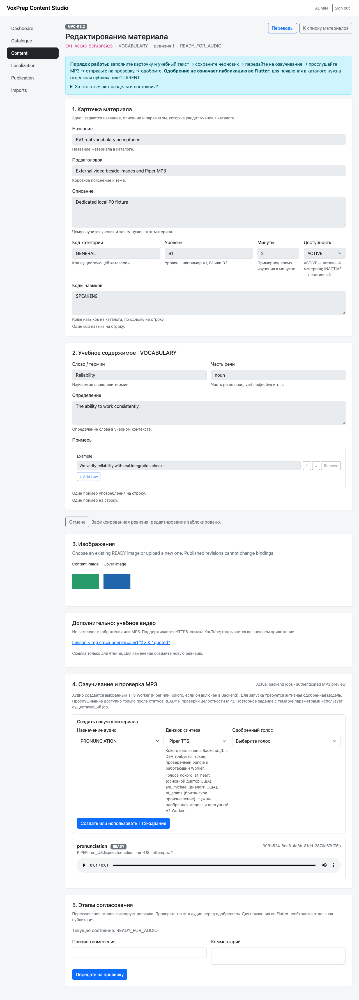

# PR #56 — local macOS P0 acceptance

Date: 2026-11-09 (Asia/Almaty). **Verdict: BLOCKED. Keep Draft; do not merge.**

This is a partial real acceptance run, not a device or full editorial PASS.
The lock defect was fixed and pushed. Backend tests, dependency resolution,
static analysis, targeted Flutter tests, actual Piper synthesis/preview and an
iOS simulator build succeeded. Mandatory publication/security/device checks
remain incomplete after host resource exhaustion and loss of local Docker/DB
responsiveness. Successful remote CI does not replace these local gates.

## Environment

| Component | Observed |
|---|---|
| macOS / CPU / RAM | 15.6 (24G84), ARM64, 16 GiB |
| Flutter / Dart | Local 3.47.7 (`abaf9c5237`) / 3.13.5; CI pins 3.47.9 |
| Xcode / CocoaPods | 26.3 (`17C529`) / 1.17.0 |
| Java / Maven | Default Java 17.0.9; selected Azul Java 21.0.10 under Rosetta for project processes only; Maven 3.8.7 |
| Docker / Compose | 28.3.2 linux/aarch64 / 2.38.2-desktop.1 |
| PostgreSQL / RustFS | Existing qualification services on 56432 / 29000; no replacement infrastructure |
| Isolation | New databases `voxprep_pr56_p0` (tests) and `voxprep_pr56_studio` (browser); backend 18082 |
| Android | SDK absent; no Android device/emulator available |
| iOS | Existing iPhone 17 Pro / iOS 26.3 simulator; build, installation and app launch succeeded |
| GitHub | Git fetch/push and connector work; CLI token cannot update workflows; existing GitHub app successfully fast-forwarded `1255e97c` without permission changes; `gh auth status` reports invalid CLI token |

The original working copy and all existing databases, containers and volumes
were preserved. An additional PR worker used a dedicated model volume. Only a
worker created by this acceptance was stopped when switching to the image built
from PR source. No prune, `down -v`, database drop, reset, force push, or merge.

Initially about 12 GiB was free. During the simulator/parallel workload it fell
below 144 MiB; screenshot saving failed and the DB stopped responding reliably.
The simulator was shut down without erasing its data. Space returned to about
12 GiB, but Docker API calls and a direct runtime-role `psql` query still timed
out. Docker Desktop UI also timed out. The shared Docker engine was **not**
restarted because it contains unrelated user services.

## Git baseline and provenance

- Branch: `feat/content-external-learning-video-v1`, PR [#56](https://github.com/alimbetov/VoxPrep/pull/56).
- Origin HEAD verified before work: `a68a08f9b4bb90e792e943e3236ec73f7f0d2f3a`.
- Dependency fix: `5008f376e9feb71216114e9ef31f727f7f387f3b`.
- Implementation/test-runner SHA: `015790830f6e375a79f1ddcaf4beb86460c61b09`.
- Final CI-configuration SHA: `1255e97cda49c311bdf2a033ee58e877f09a0b1d`; five previously default PR-merge checkouts now explicitly use PR HEAD. All eight required workflows pin the same source SHA.
- The commit containing this report adds evidence/documentation only. Resolve
  its delivery SHA with `git rev-parse HEAD`; delivery-head CI must be checked
  independently of earlier green runs. Final delivery SHA/check URLs are also
  recorded in the task completion message.
- `git diff a68a08f9 01579083 -- backend/src/main worker/src mobile/careerspeak_app/lib contracts`
  is empty. Existing image/MP3/publication/Drift contracts were not changed.
- Backend `verify` ran on the baseline backend source. The initial full Flutter
  run used the baseline checkout plus the generated lock later committed as
  `5008f376`; it was **not a clean exact-SHA full qualification**. iOS was built
  while its newly generated runner was uncommitted. These limitations are
  explicit in [commands.json](evidence/local-macos-p0/commands.json).
- A clean exact-code-SHA offline qualification on `01579083` passed: enforced
  lock, analyzer, 18 targeted tests and format (500 files, zero changes).

## Test matrix

| ID | Test | Result | Evidence / remaining work |
|---|---|---|---|
| P0-1 | Dependency lock and full local Flutter validation | FAIL | Lock/resolver/analyzer PASS; full local suite: 1058 passed, 1 skipped, 7 existing golden screenshot failures. Local SDK differs from CI; root cause of pixel differences is not conclusively isolated. Do not update baselines to hide them. |
| P0-2 | Content Studio browser workflow | BLOCKED | Real Vocabulary DRAFT, two images, video save/reopen/escaping/CSRF and real Piper MP3 playback succeeded. Publish/next revision/learner checks did not complete. |
| P0-3A | Android external launch | BLOCKED | Android SDK and devices unavailable. |
| P0-3I | iOS external launch/return | BLOCKED | Standard iOS runner added; simulator app built/installed/launched. No complete published lesson, external launch, return, offline or accessibility qualification. Resource exhaustion forced shutdown. |
| P0-4 | Eight exact-SHA CI workflows | BLOCKED at report creation | Eight succeeded on `5008f376`; all eight were rerun on `1255e97c`. See [code-head CI evidence](evidence/local-macos-p0/code-head-ci.json). Delivery/documentation SHA requires its own run; final completion message records that result. |
| REG-01 | Images preserved | PASS (local binding/preview scope) | Both real uploaded image bindings coexist with video and audio. Published learner delivery/offline persistence not qualified locally. |
| REG-02 | MP3 preserved | PASS (local TTS/Studio scope) | Actual Piper READY, authenticated MP3 fetched, browser playback reached ended with no media error. Full exact-SHA runtime correlation was not completed. |
| REG-03 | PostgreSQL → HTTP → Flutter → Drift → offline reopen | BLOCKED locally | Existing local persistence tests ran; live A1 replay blocked by infrastructure. Remote A1 is separate evidence. |
| SEC-01 | FREE/FULL authorization on real published video | BLOCKED | Existing controller tests passed; real published entitlement scenario not reached. |
| SEC-02 | Published snapshot UPDATE/DELETE protection | BLOCKED (complete gate) | PostgreSQL integration proves frozen snapshot and SQL UPDATE rejection. Live browser 409/next revision and SQL DELETE probe not reached. |
| SEC-03 | CSRF / roles / escaping | PASS in stated scopes | Browser CSRF 403 and escaping passed; five real Spring/PostgreSQL MVC integration tests include role denial and published 409. This does not substitute for complete browser P0-2. |
| FLAG-01 | Feature disabled on live server | BLOCKED | Default-off controller test passed; restarting a second live flag-off instance was not attempted after DB loss. |

The feature's optional video snapshot is CURRENT-scoped and immutable, but video
metadata is **not cryptographically included in the schema-2 ROOT hash** and is
not persisted to Drift. No stronger guarantee is claimed.

## Executed checks

Commands, SHA/working-tree provenance, actual exit codes and local log locations:
[commands.json](evidence/local-macos-p0/commands.json).

- `mvn -B -ntp -f backend/pom.xml verify`: **512 tests, 0 failures/errors,
  6 opt-in skips**, exit 0, real PostgreSQL/RustFS. Four video test classes:
  17 validation, 2 PostgreSQL lifecycle, 5 MVC and 4 learner-controller cases.
  The first sandbox attempt failed on local socket restrictions; the
  unrestricted rerun is the successful result, not a concealed retry.
- `flutter pub get`, enforced lock and a fresh manifest-only directory:
  successful resolution, identical lock SHA-256
  `3443c6cfb9e09c4872bb0a964154704c7dd7c78b0d67bc8052125bec87d68195`.
  All eight launcher package hashes match real pub cache checksum files;
  [dependency checksums](evidence/local-macos-p0/dependency-checksums.json).
- Full `flutter test --concurrency=1 --reporter expanded`: exit 1, **1058 PASS,
  1 skipped, 7 golden failures**. Raw complete log and diff images retained in
  ignored `artifacts/local-smoke/pr56/`; [failure summary](evidence/local-macos-p0/flutter-full-failure-summary.log).
- Exact `01579083` offline checks: enforced lock, analyzer, **18 targeted PASS**,
  format exit 0; [log](evidence/local-macos-p0/final-offline-qualification.log).
- Existing opt-in `LocalMacTtsModelSetupTest`: 1 PASS, real backend provisioning;
  pinned LJSpeech ONNX/config hashes verified. No fake synthesizer or mocked
  output callback was used for the Studio audio proof.
- `flutter build ios --simulator --debug --no-pub
  --dart-define=VOXPREP_API_URL=http://127.0.0.1:18082`: exit 0.
  `simctl install` and `simctl launch`: exit 0. The native HTTPS-handler test
  in the runner was not executed and is not a claimed PASS.

The existing B8 shell entry point uses Linux `stat -c`/`sha256sum` and fixed
default backend/DB ports; executing it unchanged against this Mac would target
the existing DEV infrastructure. It was inspected, not run against user data.
The native regression used the real PR worker and the normal Studio TTS flow;
full B8, H2 restart, A1 live and renderer qualification are represented by their
separate remote CI runs, not mislabeled as local results. In particular, no
shared RustFS restart was used to manufacture a local H2 PASS.

## Real browser evidence and failed attempts

The successful partial fixture is `EV1_VOCAB_53FABF0026`, revision
`d4b7ee63-951c-4041-a658-2a4c194ce44b`.

MP3 SHA-256:
`bcfcb95ca72b2b44d2d5a50359fd4351d195a39e89cdb8123f345f441acf989c`.

First automation attempt targeted the hidden wire textarea rather than its
enhanced visible Example control; the selector was corrected. The next attempt
reached APPROVED but normal publication rejected an empty active FULL
collection. This was a fixture defect, not a reason to weaken publication
validation. The corrected scenario creates a distinct premium lesson and
preserves/completes interrupted fixtures through MVC. Its subsequent run
stalled at Docker SQL access during the host incident; the bounded direct-psql
retry then timed out during create navigation. The final failed report is
[preserved unchanged](evidence/local-macos-p0/last-browser-attempt.json).

No screenshot or unit/controller PASS is presented as a successful publication
or completed mobile acceptance.

## Defect registry

| Severity | Finding / root cause | Fix | Regression / retest |
|---|---|---|---|
| P0 | `url_launcher` declared without resolver-generated lock entries | `5008f376` adds eight real resolved packages and macOS registrant | Enforced lock, fresh resolution, checksum match, analyzer and targeted tests PASS |
| P1 | No iOS runner, so requested simulator build impossible | `01579083` adds standard Flutter iOS project and platform metadata | Simulator debug build/install/launch PASS; full device gate BLOCKED |
| P1 | Five CI workflows used default PR merge-ref checkout rather than explicit head SHA | `1255e97c` pins PR head in all eight required workflows; no tests/assertions removed | Exact-head workflows rerun; delivery HEAD independently checked |
| P1 environment | Simulator/parallel workload exhausted host space; Docker/PG then timed out | Simulator shut down preserving data; heavy work stopped; no unrelated engine restart | Space recovered; local integration remains BLOCKED |
| P2 unclassified | Seven existing golden baselines differ on local Flutter 3.47.7/macOS vs pinned CI environment | No visual baseline/assertion changes | Local full suite FAIL; separate CI results do not erase this observation |
| Test harness | Hidden enhanced Example input / empty active FULL fixture | `01579083` browser selectors and distinct premium fixture | Earlier failure evidence retained; entire corrected browser script remains NOT QUALIFIED |

## Resume / minimum manual checklist

Follow [REPRODUCE.md](evidence/local-macos-p0/REPRODUCE.md). Restore a responsive
Docker engine and adequate disk/RAM first, without erasing existing volumes.
Run heavy stages sequentially. Use the pinned Flutter SDK for pixel comparison;
do not globally upgrade the user's existing SDK or run `pub upgrade`.

1. Complete actual browser publication with FREE and FULL fixtures; verify
   authenticated learner video 200/204, FREE→FULL denial, flag-off, roles/CSRF,
   published save/remove 409, rolled-back runtime SQL UPDATE/DELETE probes,
   next DRAFT revision and unchanged previous snapshot/media bindings.
2. Run existing live A1 PostgreSQL→HTTP→Flutter→Drift offline-reopen qualification
   and isolated B8/H2 regressions with safe environment/ports.
3. Android: provide SDK/device. iOS: reopen the preserved simulator after
   restoring resources. On both, open the published lesson from `lib/main.dart`,
   verify photos/text/audio, tap video once, confirm exact external HTTPS URL,
   return to same lesson/progress/playback state without relaunch, and exercise
   offline/launch-refusal/no-YouTube cases, 200% text and screen reader controls.
4. Commit any necessary fix, then require eight SUCCESS workflows on the new
   exact HEAD. Earlier SHA results are not acceptance of a changed HEAD.

## Final verdict

**BLOCKED.** Dependency correction and partial real integration are substantive
results, but mandatory P0-2 and both complete mobile gates lack evidence. Keep
PR #56 Draft even if delivery-head CI is 8/8 green. No merge to `main`.
